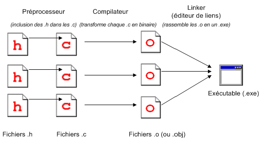
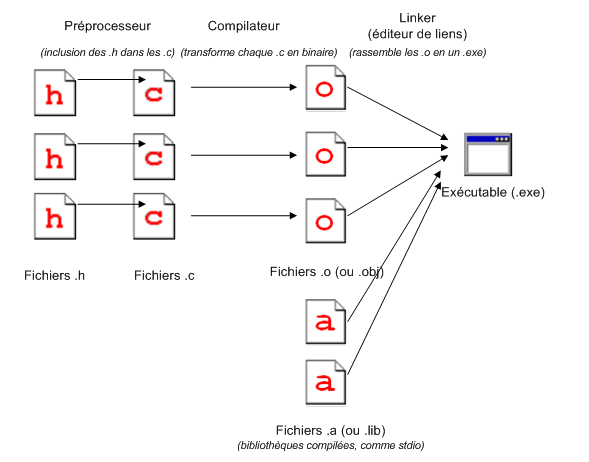

# La compilation

Ce chapitre va aussi reprendre quelques éléments du cours sur les préprocesseurs.

## Fonctionnement

La compilation est effectuée de manière séparée. Voici un schéma de fonctionnement.

### Le préprocesseur

C'est le programme qui démarre avant la compilation. Il exécute les instructions spéciales données dans les directive de préprocesseur `#`.

### La compilation

C'est la partie qui transforme les fichiers `*.c` en code binaire dans un fichier `*.o` ou `*.obj`.

Il pout être intéressant de garder quelques fichiers de ce type entre deux compilations. Cela offre la possibilité de ne pas recompiler tout le projet si l'on ne modifie qu'un seul fichier.

### Le linker

Voici un schéma un peu plus complet de la compilation.

Nous voyons maintenant des fichier `*.a` ou `*.lib`. Ce sont les fichiers déjà compilé des bibliothèques que nous allons utiliser en complément de nos fichiers.

Le linker lui va rassemblé l'ensemble des fichiers compilés pour en générer le fichier exécutable.
